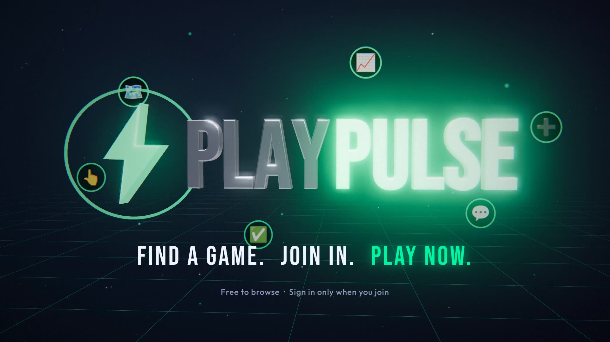

# PlayPulse explainer film

An 84-second 3D explainer of how PlayPulse works, with narration, an original
score and sound design.



**[playpulse-explainer.mp4](playpulse-explainer.mp4)**: H.264 1920×1080 at 30 fps,
AAC 48 kHz stereo, mastered to −14 LUFS so it plays at a consistent level on
YouTube, Instagram and LinkedIn. Subtitles are burned in, so it also works muted.

## What it walks through

| Time | Beat | What the viewer sees | Where it lives in the app |
| --- | --- | --- | --- |
| 0:00 | Hook | Group-chat chaos: "Finding a game shouldn't take 50 messages" | — |
| 0:06 | Reveal | Heartbeat line becomes the bolt; PLAYPULSE lockup | `public/icon.svg` |
| 0:14 | 01 Discover | 3D city map, sport pins dropping in, filters syncing with the phone, LIVE games called out | `MapScreen` |
| 0:24 | 02 Join | When, where, skill and spots left fly out of the match; one tap joins; calendar and share | `MatchDetailScreen` overview |
| 0:34 | 03 Check in | The five check-in steps light up along a route; the organiser sees who's where | Check-in tab, `CHECK_STEPS` |
| 0:44 | 04 Game on | Match/team chat, live scoreboard with ball-by-ball commentary, the stream | Chat, Score, Stream tabs |
| 0:56 | 05 Host | The + button, the create form filling in, the new match landing on the map; weekly and invite-only | `CreateScreen` |
| 1:06 | 06 Level up | Portfolio record, competitive vs practice split, reliability score, milestones | `PortfolioScreen` |
| 1:16 | End card | "Find a game. Join in. Play now." | — |

Every claim in the narration maps to something the app does today. The demo
board in the film (player names, venues, scores) is illustrative.

## How it's made

- **Picture.** Three.js scenes rendered frame by frame in headless Chromium.
  Each frame is a pure function of time, so several browsers render separate
  ranges in parallel. The phone screens are redrawn in `web/ui.js` from the
  app's own design tokens (`src/styles/theme.js`), copy and layout. Bloom plus a
  custom post pass provide the transitions: zoom blur, whip pans, glitch, flash.
- **Narration.** Kokoro-82M (the `af_heart` voice), synthesised locally. Phrase
  boundaries are measured from the audio (`pauses.py`) and drive the subtitles
  and on-screen events. For example, each check-in step lights on the word that
  names it.
- **Score and effects.** Synthesised from scratch in `music.py` at 120 BPM
  (Am–F–C–G). The picture registers 167 sound cues, so every tap, whoosh and
  impact lands on its frame. Music ducks about 8 dB under speech; the master
  is limited to −1 dBTP.

## Changing it

| File | What it controls |
| --- | --- |
| `source/web/timeline.json` | Scene cuts, transitions, narration offsets, subtitles |
| `source/web/scenes.js` | The nine scenes: layout, camera moves, animation timing |
| `source/web/ui.js` | The phone screens and their demo data |
| `source/tts.py` | The narration script and voice |
| `source/music.py` | Arrangement, sound design and mix |

```bash
cd promo/source
./build.sh           # re-render picture and audio, then encode
./build.sh --voice   # also regenerate the narration after editing tts.py
```

It needs Node 18+, Python 3.11+, ffmpeg and a Chromium that `playwright-core`
1.56 can launch. On four CPU cores with software WebGL a full render takes
about 50 minutes; frames already on disk are skipped, so an interrupted build
resumes where it stopped.

## Credits

- [three.js](https://threejs.org): MIT
- [Kokoro-82M](https://huggingface.co/hexgrad/Kokoro-82M): Apache-2.0; weights
  via the `kokoro-q8-shards` npm package (sha256-checked against upstream),
  voices via `kokoro-js`
- Bebas Neue and Outfit: SIL Open Font License, via Fontsource
- Noto Color Emoji: SIL Open Font License
- Music and sound effects: original, generated by `music.py`
